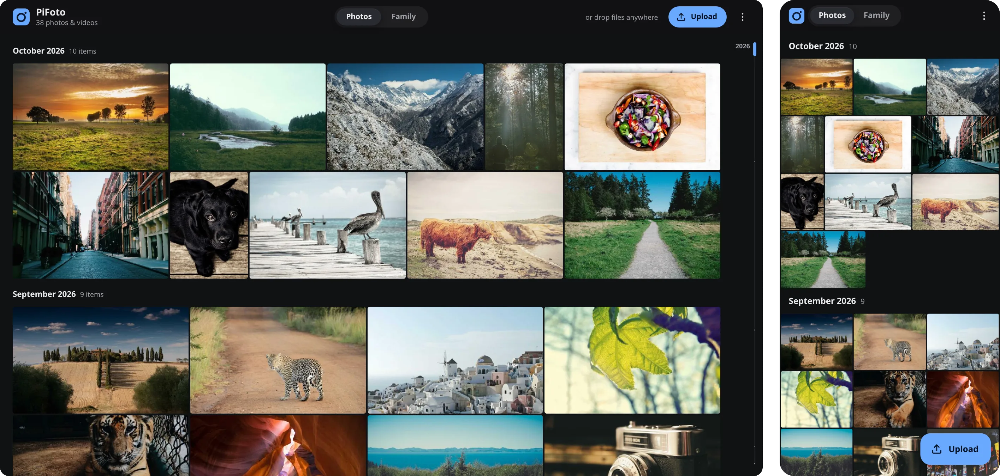

# PiFoto

An extremely lightweight, self-hosted photo library for a family: a minimal Google Photos
alternative that runs on a Raspberry Pi 1 at home.



10 MB binary · 45 MB of RAM for 25,000 photos and videos · Raspberry Pi 1, 512 MB · Go standard library only

- A private library for each person and a shared Family album, with invites by link and storage limits
- An Android app that backs up new photos and videos at home and away, and updates itself
- Import from Google Takeout, with every duplicate stored once
- No database: the index is one JSON file, and the whole web UI is one HTML file inside the binary

## Quick start

Needs Go and `djpeg` (Debian/Raspberry Pi OS: `apt install libjpeg-turbo-progs`).

```sh
# create the first (admin) account; the password is read from stdin
echo 'a long password' | go run . -data ./library -set-password -user Jonas
go run . -data ./library -addr :8080      # then open http://localhost:8080
```

## On a Raspberry Pi

```sh
CGO_ENABLED=0 GOOS=linux GOARCH=arm GOARM=6 go build -trimpath -ldflags='-s -w' -o pifoto-armv6 .
```

Copy the binary to `/opt/pifoto/pifoto` and install `deploy/pifoto.service`, a sandboxed systemd
unit; its comments say where your own settings go. To use PiFoto away from home, give it a
public HTTPS address (for example with Tailscale Funnel) and pass that with `-remote-url`.

## Android app

Put your server's public address in `android/local.properties`:

```properties
pifoto.publicServer=https://your-pi.example.ts.net
```

Then build with `cd android && ./gradlew assembleRelease`. Release signing reads
`~/.config/pifoto/release-signing.properties` (`storeFile`, `storePassword`, `keyAlias`,
`keyPassword`). Put the APK in `<data>/app/` (see `tools/publish-app.sh`): phones download it
from `/app`, and installed apps update themselves.

## Import from Google Takeout

```sh
go build -o takeout-import ./tools/takeout-import
./takeout-import -server http://your-pi -password-file pw.txt -dry-run takeout-*.zip
```

It reads the ZIPs directly, skips duplicates, and can be stopped and run again. Drop `-dry-run`
to upload.

## More

- API and security rules: `docs/family-api.md`
- Tests: `go test ./...`; synthetic test photos: `go run ./tools/mkphotos OUTDIR [count]`
- The photos in the screenshot are from [Unsplash](https://unsplash.com), via [Lorem Picsum](https://picsum.photos)
